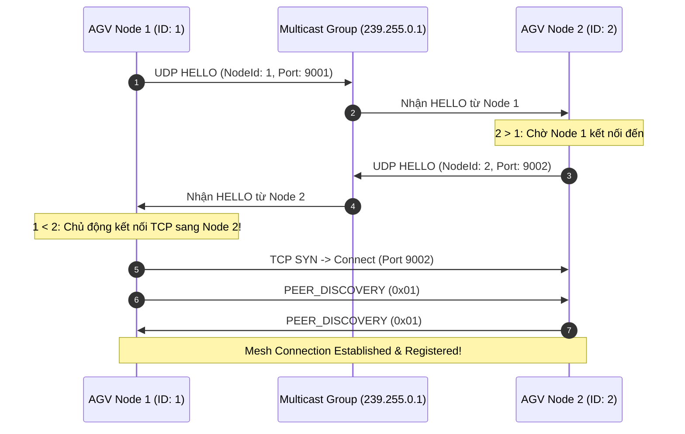
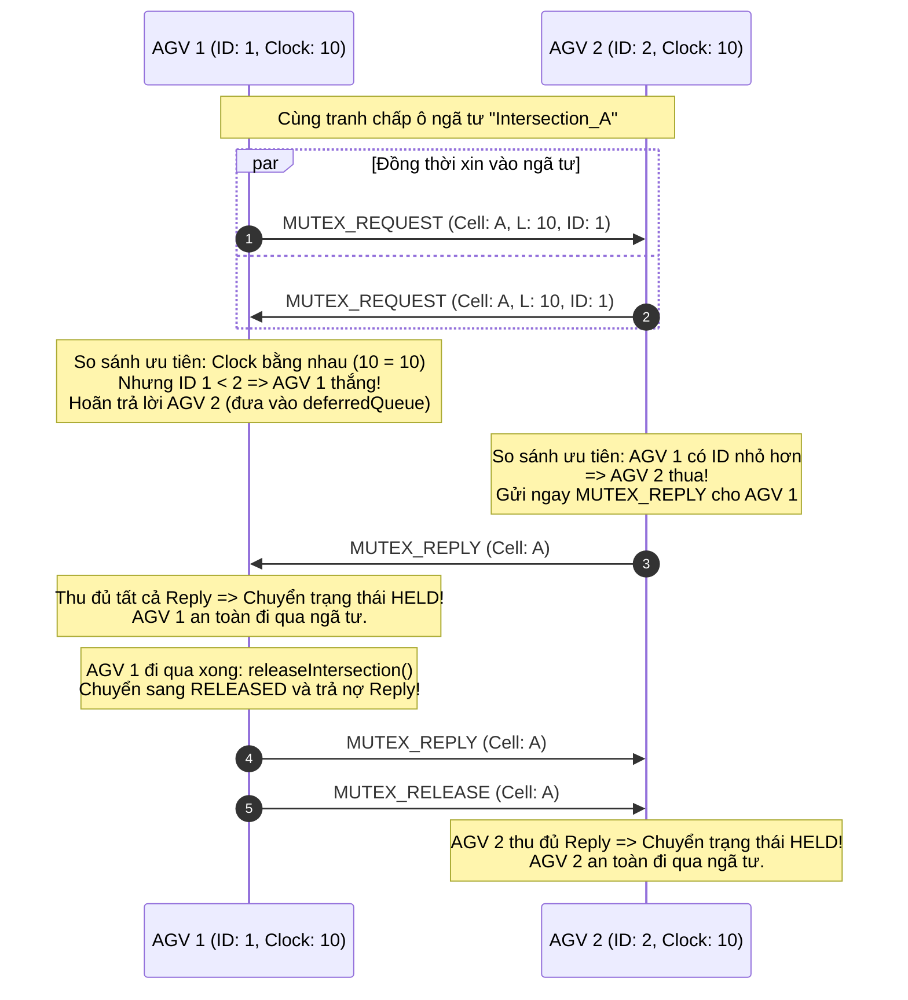
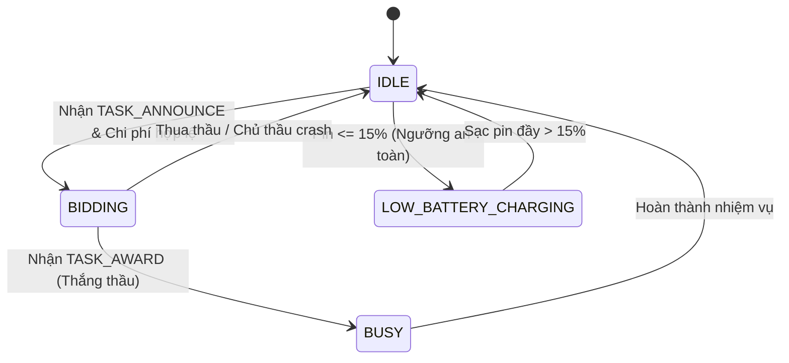
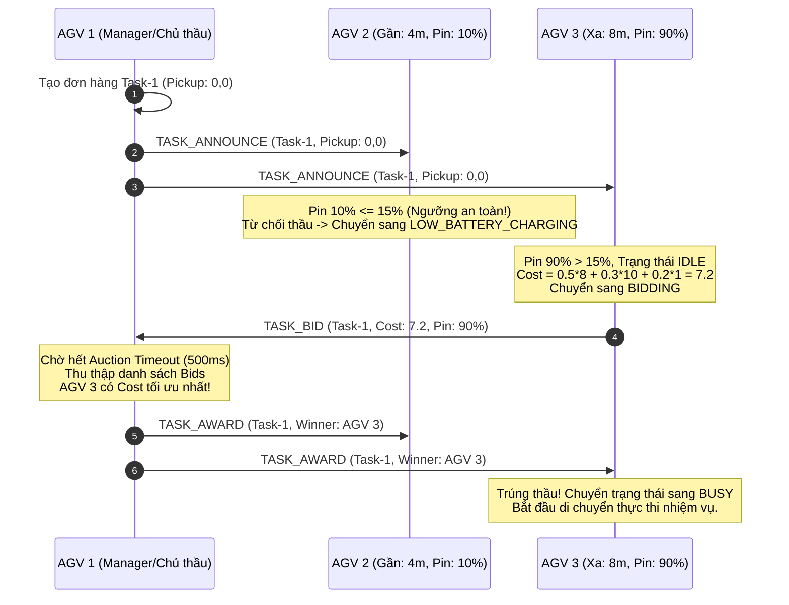
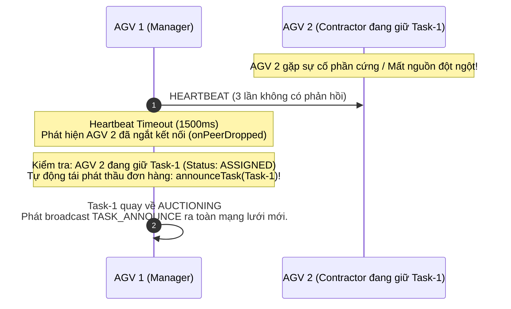
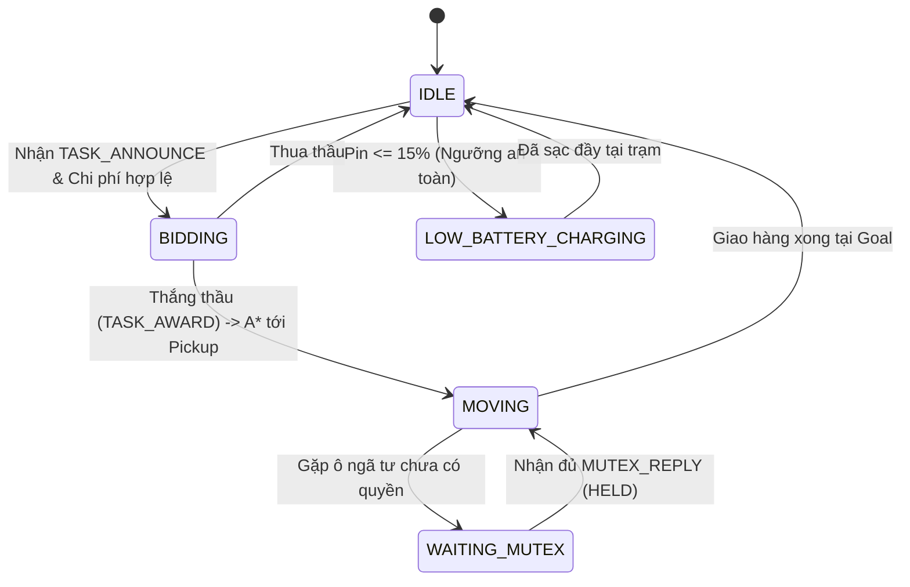

# Kiến trúc và Luồng Hoạt động Toàn diện (Architecture & Workflow Specification)
## Đề tài: Hệ thống điều phối đội xe tự hành (AGV Fleet) phi tập trung trên nền tảng Pure P2P Event Bus bằng Java

---

## 1. Tổng quan Kiến trúc Hệ thống (System Architecture)

Hệ thống được thiết kế theo mô hình **Pure Peer-to-Peer (P2P)** phi tập trung 100%, không sử dụng Broker trung tâm (như RabbitMQ, Kafka hay MQTT Broker) và không có Master/Coordinator node. Mỗi AGV là một thực thể độc lập (**Autonomous Agent**), tự vận hành các dịch vụ mạng, thuật toán phân tán và tác tử điều phối nhiệm vụ.

```mermaid
graph TB
    subgraph AGV_Node_Stack ["AGV Autonomous Node Stack"]
        subgraph Layer5 ["Layer 5: Navigation & JavaFX 2D Canvas Dashboard"]
            GUI[JavaFX 2D Canvas Simulator Dashboard]
            RobotLifecycle[AgvRobot: Movement & State Coordinator]
            AStar[Dynamic A* Pathfinder: Obstacle & Collision Avoidance]
            GridMap[Warehouse GridMap: 24x16 Layout]
        end

        subgraph Layer4 ["Layer 4: Multi-Agent Coordination (CNP Engine)"]
            CNP[Contract Net Protocol Engine]
            AgentState[Agent State Machine: IDLE / BIDDING / BUSY / MOVING / MUTEX]
            Battery[AgvBattery & Energy Safety Policy]
        end

        subgraph Layer3 ["Layer 3: Distributed Consensus & Synchronization"]
            Lamport[Lamport Logical Clock]
            RicartAgrawala[Ricart-Agrawala Mutual Exclusion Engine]
            CellMutex[Intersection Cell Conflict Resolution]
        end

        subgraph Layer2 ["Layer 2: P2P Mesh Transport & Discovery"]
            PeerManager[PeerManager: Topology & Deduplication]
            UDPDisc[UDP Multicast Auto-Discovery: 239.255.0.1:9876]
            Heartbeat[Heartbeat Controller & Failure Detector]
            TCPServer[Netty TCP Server: Inbound]
            TCPClient[Netty TCP Client: Outbound]
        end

        subgraph Layer1 ["Layer 1: High-Performance Binary Protocol"]
            Encoder[AgvPacketEncoder: ByteBuf Serialization]
            Decoder[AgvPacketDecoder: Frame Extraction & CRC32 Validation]
            FrameSpec[36-Byte Fixed Header + Binary Payload]
        end
    end

    Layer5 --> Layer4
    Layer4 --> Layer3
    Layer3 --> Layer2
    Layer2 --> Layer1
```



---

## 2. Đặc tả Tầng Giao thức Nhị phân (Binary Protocol Layer)

### 2.1. Cấu trúc Khung Nhị phân (Binary Frame Layout)

Khung truyền thông có phần đầu cố định (**Fixed Header**) đúng **36 Bytes**, định dạng Big-Endian:

```
 0                   1                   2                   3
 0 1 2 3 4 5 6 7 8 9 0 1 2 3 4 5 6 7 8 9 0 1 2 3 4 5 6 7 8 9 0 1
+-+-+-+-+-+-+-+-+-+-+-+-+-+-+-+-+-+-+-+-+-+-+-+-+-+-+-+-+-+-+-+-+
|       Magic (0xCAFE)          |    Opcode     |    Version    | (4 bytes)
+-+-+-+-+-+-+-+-+-+-+-+-+-+-+-+-+-+-+-+-+-+-+-+-+-+-+-+-+-+-+-+-+
|                                                               |
+                       Sequence ID (64-bit)                    + (8 bytes)
|                                                               |
+-+-+-+-+-+-+-+-+-+-+-+-+-+-+-+-+-+-+-+-+-+-+-+-+-+-+-+-+-+-+-+-+
|                                                               |
+                    Lamport Timestamp (64-bit)                 + (8 bytes)
|                                                               |
+-+-+-+-+-+-+-+-+-+-+-+-+-+-+-+-+-+-+-+-+-+-+-+-+-+-+-+-+-+-+-+-+
|                                                               |
+                    Sender Node ID (64-bit)                    + (8 bytes)
|                                                               |
+-+-+-+-+-+-+-+-+-+-+-+-+-+-+-+-+-+-+-+-+-+-+-+-+-+-+-+-+-+-+-+-+
|                      Payload Length (32-bit)                  | (4 bytes, offset=28)
+-+-+-+-+-+-+-+-+-+-+-+-+-+-+-+-+-+-+-+-+-+-+-+-+-+-+-+-+-+-+-+-+
|                      CRC32 Checksum (32-bit)                  | (4 bytes, offset=32)
+-+-+-+-+-+-+-+-+-+-+-+-+-+-+-+-+-+-+-+-+-+-+-+-+-+-+-+-+-+-+-+-+
|                                                               |
+                       Payload Data (N Bytes)                  + (N bytes, offset=36)
|                                                               |
+-+-+-+-+-+-+-+-+-+-+-+-+-+-+-+-+-+-+-+-+-+-+-+-+-+-+-+-+-+-+-+-+
```

### 2.2. Danh mục Opcode

| Mã Hex | Giá trị | Tên Opcode | Tầng sử dụng | Mục đích nghiệp vụ |
| :---: | :---: | :--- | :--- | :--- |
| `0x01` | `1` | `PEER_DISCOVERY` | Layer 2 | Handshake nhận dạng node ngay sau khi TCP Channel kích hoạt |
| `0x02` | `2` | `HEARTBEAT` | Layer 2 | Gói tin nhịp tim định kỳ (Payload rỗng, CRC32 = 0) |
| `0x10` | `16` | `MUTEX_REQUEST` | Layer 3 | Yêu cầu quyền vào ô ngã tư phân tán |
| `0x11` | `17` | `MUTEX_REPLY` | Layer 3 | Phản hồi cấp phép vào ô ngã tư |
| `0x12` | `18` | `MUTEX_RELEASE` | Layer 3 | Giải phóng ngã tư sau khi xe đã đi qua |
| `0x20` | `32` | `TASK_ANNOUNCE` | Layer 4 | Phát thầu nhiệm vụ vận chuyển hàng (pickup & delivery) |
| `0x21` | `33` | `TASK_BID` | Layer 4 | Nộp hồ sơ dự thầu kèm chi phí và mức pin |
| `0x22` | `34` | `TASK_AWARD` | Layer 4 | Trao thầu đơn hàng cho AGV có chi phí tối ưu nhất |

---

## 3. Tầng Truyền tải P2P Mesh & Tự khám phá (Layer 2)

### 3.1. Cơ chế Tự động Khám phá (UDP Multicast Auto-Discovery)
- Mỗi AGV lắng nghe và định kỳ phát tín hiệu HELLO qua địa chỉ multicast `239.255.0.1:9876`.
- Bản tin HELLO chứa: `nodeId`, `host`, `tcpPort`.

### 3.2. Quy tắc Chống trùng lặp kết nối (Duplicate Connection Prevention)
Để thiết lập mạng lưới Full-Mesh $O(N^2)$ giữa $N$ xe mà không bị mở 2 kết nối TCP song song giữa cùng một cặp xe:
- **Quy tắc bắt buộc**: Khi phát hiện node lân cận, chỉ node có `nodeId < peerId` mới được phép khởi tạo kết nối TCP Outbound (TCP Client) tới node có ID lớn hơn.
- Node có `nodeId > peerId` chỉ chờ kết nối Inbound từ node nhỏ hơn.



---

## 4. Tầng Đồng thuận & Đồng bộ Phân tán (Layer 3)

### 4.1. Đồng hồ Logic Lamport (`LamportClock`)
- Đảm bảo tính thứ tự nhân quả (causal order) trong môi trường phân tán hoàn toàn:
  - Trước khi gửi tin hoặc có biến cố nội bộ: $L = L + 1$.
  - Khi nhận gói tin mang nhãn $L_{\text{recv}}$: $L = \max(L, L_{\text{recv}}) + 1$.

### 4.2. Thuật toán Ricart-Agrawala giải quyết Xung đột Ngã tư



---

## 5. Tầng Đấu thầu Công việc Tự động - Contract Net Protocol (Layer 4)

### 5.1. Mô hình Vòng đời Trạng thái Tác tử (Agent State Machine)



### 5.2. Hàm Tính Toán Chi Phí Đấu Thầu (Cost Function)

Mỗi xe AGV khi nhận bản tin phát thầu `TASK_ANNOUNCE` sẽ tự động tính hàm chi phí:

$$C = 0.5 \times d_{\text{pickup}} + 0.3 \times (100.0 - B) + 0.2 \times W_{\text{maintenance}}$$

Trong đó:
- $d_{\text{pickup}} = \sqrt{(x_{\text{pickup}} - x_{\text{agv}})^2 + (y_{\text{pickup}} - y_{\text{agv}})^2}$: Khoảng cách di chuyển đến điểm lấy hàng. Trọng số $0.5$ ưu tiên xe ở gần.
- $B \in [0.0, 100.0]$: Mức pin hiện tại của xe. $(100 - B)$ là độ cạn kiệt pin. Trọng số $0.3$ phạt nặng xe có mức pin thấp.
- $W_{\text{maintenance}}$: Trọng số hao mòn thiết bị và chu kỳ bảo dưỡng (mặc định $1.0$).

### 5.3. Luồng Đấu Thầu Thích Ứng (Adaptive Auction Workflow)



### 5.4. Cơ chế Chịu lỗi khi Node Sập (Fault-Tolerance & Re-Auctioning)



---

## 6. Tầng Điều hướng Dynamic A* và Mô phỏng Trực quan JavaFX 2D (Layer 5)

### 6.1. Thuật toán Dynamic A* Pathfinding (`DynamicAStarPathfinder`)
- Tìm kiếm đường đi ngắn nhất không va chạm từ `(startX, startY)` đến `(goalX, goalY)`:
  $$f(n) = g(n) + h(n)$$
  - $g(n)$: Chi phí thực tế tích lũy từ điểm xuất phát (1.0 đơn vị mỗi bước).
  - $h(n) = |n.x - \text{goal}.x| + |n.y - \text{goal}.y|$: Manhattan heuristic phù hợp cho chuyển động trực giao 4 hướng.
- Tránh vật cản tĩnh: Kệ hàng (`OBSTACLE`) trong kho.
- Tránh vật cản động: Vị trí của các xe AGV khác đang dừng đỗ (`dynamicObstacles`).

### 6.2. Vòng đời Điều phối AGV Robot (`AgvRobot`)


### 6.3. Kiến trúc Giao diện Dashboard JavaFX Canvas 2D (`AgvFleetSimulatorApp`)
- **Tốc độ hiển thị**: 30-60 FPS với `AnimationTimer` và phép nội suy vị trí mượt mà (Linear Interpolation).
- **Mã màu trạng thái xe**:
  - 🟦 `IDLE`: Sẵn sàng nhận việc
  - 🟪 `BIDDING`: Đang nộp hồ sơ thầu
  - 🟩 `MOVING`: Đang di chuyển lấy/giao hàng
  - 🟧 `WAITING_MUTEX`: Đang dừng nhường đường ngã tư
  - 🟩 `LOW_BATTERY_CHARGING`: Đang sạc tại trạm
  - 🟥 `CRASHED`: Mô phỏng hỏng hóc / mất nguồn
- **Tính năng Điều khiển & Tương tác**:
  - *"Spawn New Task"*: Phát thầu đơn hàng ngẫu nhiên qua CNP.
  - *"Simulate Head-On Conflict"*: Điều hướng 2 AGV đâm đối đầu qua 1 ngã tư để chứng minh Ricart-Agrawala giải quyết 0 deadlock.
  - *"Kill Selected AGV"*: Giả lập sập nguồn 1 xe chứng minh tự phục hồi P2P.
  - *"Add New AGV"*: Khởi tạo node AGV mới tham gia mesh tự động qua UDP discovery.

---

## 7. Tổng hợp Bộ Kiểm thử Đã Xác Thực (Verification & Test Suite)

Dự án hiện có **36 bài kiểm thử hoàn chỉnh** (Unit Tests & Multi-Node Integration Tests), tỷ lệ đạt **100% (36/36 PASSED, 0 Failures)**:

```
[INFO] Results:
[INFO] Tests run: 36, Failures: 0, Errors: 0, Skipped: 0
[INFO] BUILD SUCCESS
```

| Tầng | Lớp Test | Số lượng Test | Nội dung kiểm thử chính |
| :--- | :--- | :---: | :--- |
| **Layer 1: Codec** | `AgvCodecTest` | 8 | Mã hóa/giải mã, dính gói (sticky), vỡ gói (fragmented), sai CRC32, sai Magic/Opcode, gói rỗng. |
| **Layer 2: Mesh** | `P2PMeshIntegrationTest` | 3 | Tự khám phá 3 node Full-Mesh, Broadcast ứng dụng, Phát hiện node crash qua Heartbeat timeout. |
| **Layer 3: Clock** | `LamportClockTest` | 3 | Tăng tiến đồng hồ nội bộ, Cập nhật đồng hồ Lamport với timestamp lớn hơn/nhỏ hơn. |
| **Layer 3: Mutex** | `MutexPayloadTest` | 3 | Serialize/deserialize nhị phân cho `MutexRequestPayload`, `MutexReplyPayload`, `MutexReleasePayload`. |
| **Layer 3: Mutex** | `RicartAgrawalaTest` | 3 | Mạng 1 node xin vào ngã tư ngay, 2 node đâm đối đầu (phân giải theo ID, 0 deadlock), Node crash tự giải phóng ngã tư. |
| **Layer 4: CNP** | `CnpPayloadTest` | 4 | Round-trip nhị phân `TaskAnnouncePayload`, `TaskBidPayload`, `TaskAwardPayload` và validation. |
| **Layer 4: CNP** | `CnpAuctionTest` | 4 | Phạt pin yếu ($\le 15\%$) đi sạc; Đa xe nộp thầu chọn min cost; Xe `BUSY` bỏ qua đấu thầu; Tái phát thầu khi thầu phụ crash. |
| **Layer 5: Map** | `GridMapTest` | 3 | Kích thước bản đồ, phân loại ô (Obstacle, Intersection, Dock), sinh bản đồ kho mẫu 24x16. |
| **Layer 5: Path** | `AStarPathfinderTest` | 5 | Đường thẳng, vòng qua kệ hàng tĩnh, tránh xe đỗ động, bao vây không lối đi, điểm xuất phát trùng đích. |
| **Tổng cộng** | | **36** | **Toàn bộ 5 tầng hoạt động hoàn hảo, chuẩn chỉ, thread-safe, không có broker.** |
