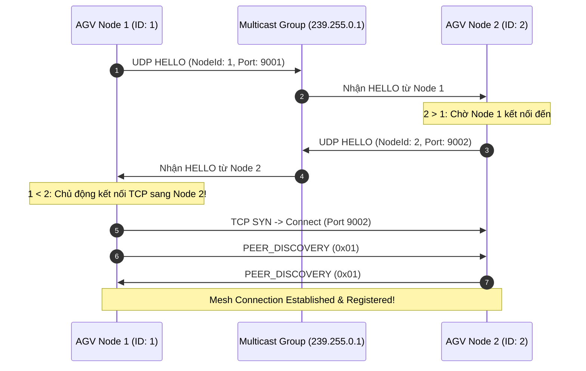
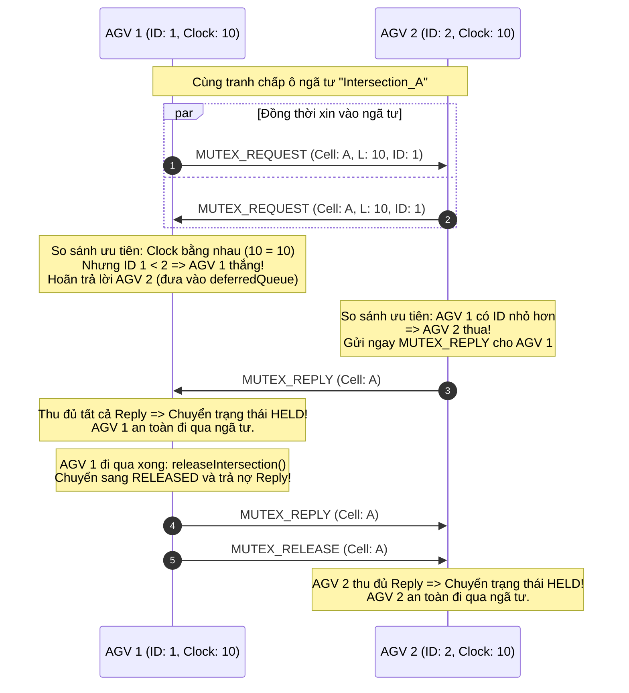
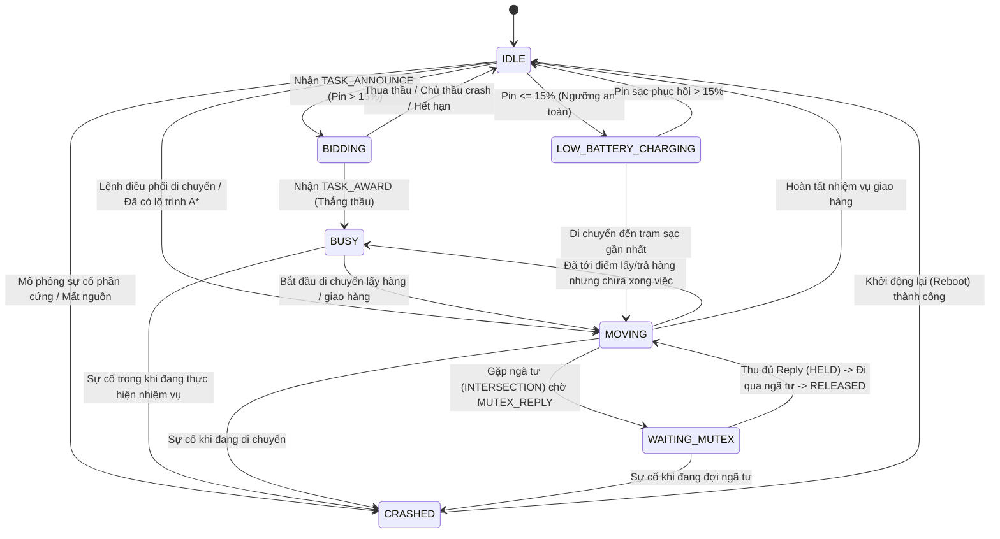
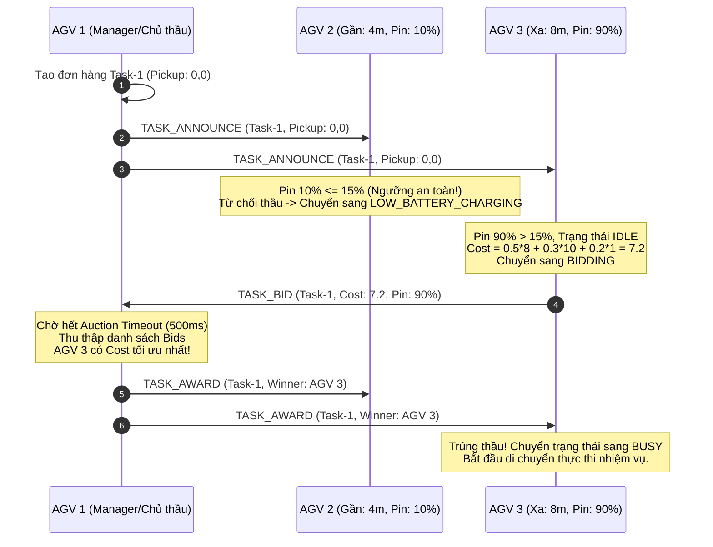
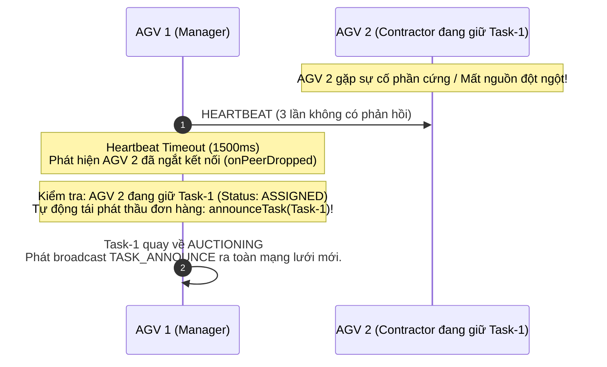
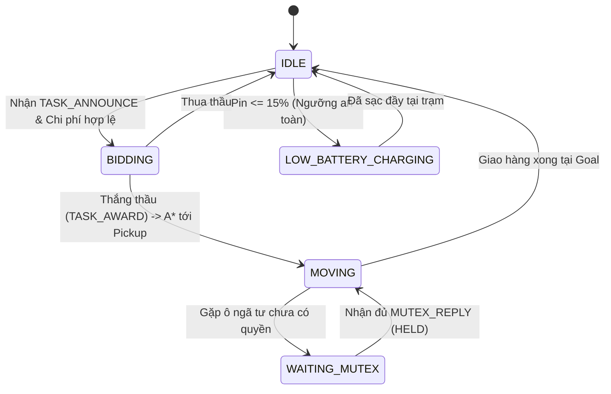

# Kiến trúc và Luồng Hoạt động Toàn diện (Architecture & Workflow Specification)
## Đề tài: Hệ thống điều phối đội xe tự hành (AGV Fleet) phi tập trung trên nền tảng Pure P2P Event Bus bằng Java

---

## 1. Tổng quan Kiến trúc Hệ thống (System Architecture)

Hệ thống được thiết kế theo mô hình **Pure Peer-to-Peer (P2P)** phi tập trung 100%, không sử dụng Broker trung tâm (như RabbitMQ, Kafka hay MQTT Broker) và không có Master/Coordinator node. Mỗi AGV là một thực thể độc lập (**Autonomous Agent**), tự vận hành các dịch vụ mạng, thuật toán phân tán và tác tử điều phối nhiệm vụ.

```mermaid
graph TB
    subgraph AGV_Node_Stack ["AGV Autonomous Node Stack"]
        subgraph Layer5 ["Layer 5: Navigation & JavaFX 2D Canvas Dashboard"]
            GUI[JavaFX 2D Canvas Simulator Dashboard]
            RobotLifecycle[AgvRobot: Movement & State Coordinator]
            AStar[Dynamic A* Pathfinder: Obstacle & Collision Avoidance]
            GridMap[Warehouse GridMap: 24x16 Layout]
        end

        subgraph Layer4 ["Layer 4: Multi-Agent Coordination (CNP Engine)"]
            CNP[Contract Net Protocol Engine]
            AgentState[Agent State Machine: IDLE / BIDDING / BUSY / MOVING / MUTEX]
            Battery[AgvBattery & Energy Safety Policy]
        end

        subgraph Layer3 ["Layer 3: Distributed Consensus & Synchronization"]
            Lamport[Lamport Logical Clock]
            RicartAgrawala[Ricart-Agrawala Mutual Exclusion Engine]
            CellMutex[Intersection Cell Conflict Resolution]
        end

        subgraph Layer2 ["Layer 2: P2P Mesh Transport & Discovery"]
            PeerManager[PeerManager: Topology & Deduplication]
            UDPDisc[UDP Multicast Auto-Discovery: 239.255.0.1:9876]
            Heartbeat[Heartbeat Controller & Failure Detector]
            TCPServer[Netty TCP Server: Inbound]
            TCPClient[Netty TCP Client: Outbound]
        end

        subgraph Layer1 ["Layer 1: High-Performance Binary Protocol"]
            Encoder[AgvPacketEncoder: ByteBuf Serialization]
            Decoder[AgvPacketDecoder: Frame Extraction & CRC32 Validation]
            FrameSpec[36-Byte Fixed Header + Binary Payload]
        end
    end

    Layer5 --> Layer4
    Layer4 --> Layer3
    Layer3 --> Layer2
    Layer2 --> Layer1
```



---

## 2. Đặc tả Tầng Giao thức Nhị phân (Binary Protocol Layer)

### 2.1. Cấu trúc Khung Nhị phân (Binary Frame Layout)

Khung truyền thông có phần đầu cố định (**Fixed Header**) đúng **36 Bytes**, định dạng Big-Endian:

```
 0                   1                   2                   3
 0 1 2 3 4 5 6 7 8 9 0 1 2 3 4 5 6 7 8 9 0 1 2 3 4 5 6 7 8 9 0 1
+-+-+-+-+-+-+-+-+-+-+-+-+-+-+-+-+-+-+-+-+-+-+-+-+-+-+-+-+-+-+-+-+
|       Magic (0xCAFE)          |    Opcode     |    Version    | (4 bytes)
+-+-+-+-+-+-+-+-+-+-+-+-+-+-+-+-+-+-+-+-+-+-+-+-+-+-+-+-+-+-+-+-+
|                                                               |
+                       Sequence ID (64-bit)                    + (8 bytes)
|                                                               |
+-+-+-+-+-+-+-+-+-+-+-+-+-+-+-+-+-+-+-+-+-+-+-+-+-+-+-+-+-+-+-+-+
|                                                               |
+                    Lamport Timestamp (64-bit)                 + (8 bytes)
|                                                               |
+-+-+-+-+-+-+-+-+-+-+-+-+-+-+-+-+-+-+-+-+-+-+-+-+-+-+-+-+-+-+-+-+
|                                                               |
+                    Sender Node ID (64-bit)                    + (8 bytes)
|                                                               |
+-+-+-+-+-+-+-+-+-+-+-+-+-+-+-+-+-+-+-+-+-+-+-+-+-+-+-+-+-+-+-+-+
|                      Payload Length (32-bit)                  | (4 bytes, offset=28)
+-+-+-+-+-+-+-+-+-+-+-+-+-+-+-+-+-+-+-+-+-+-+-+-+-+-+-+-+-+-+-+-+
|                      CRC32 Checksum (32-bit)                  | (4 bytes, offset=32)
+-+-+-+-+-+-+-+-+-+-+-+-+-+-+-+-+-+-+-+-+-+-+-+-+-+-+-+-+-+-+-+-+
|                                                               |
+                       Payload Data (N Bytes)                  + (N bytes, offset=36)
|                                                               |
+-+-+-+-+-+-+-+-+-+-+-+-+-+-+-+-+-+-+-+-+-+-+-+-+-+-+-+-+-+-+-+-+
```

### 2.2. Danh mục Opcode

| Mã Hex | Giá trị | Tên Opcode | Tầng sử dụng | Mục đích nghiệp vụ |
| :---: | :---: | :--- | :--- | :--- |
| `0x01` | `1` | `PEER_DISCOVERY` | Layer 2 | Handshake nhận dạng node ngay sau khi TCP Channel kích hoạt |
| `0x02` | `2` | `HEARTBEAT` | Layer 2 | Gói tin nhịp tim định kỳ kiểm tra sống chết (liveness check) |
| `0x03` | `3` | `POSITION_UPDATE`| Layer 2/5 | Quảng bá tọa độ thời gian thực của xe khi di chuyển giữa các ô |
| `0x04` | `4` | `PING` | Layer 2/Diag | Gói tin chẩn đoán đo trễ Round-Trip Time mang 8-byte nanoTime |
| `0x05` | `5` | `PONG` | Layer 2/Diag | Phản hồi đo trễ dội lại nanoTime đo RTT một chiều (RTT/2) |
| `0x10` | `16` | `MUTEX_REQUEST` | Layer 3 | Yêu cầu quyền vào ô ngã tư phân tán (Ricart-Agrawala) |
| `0x11` | `17` | `MUTEX_REPLY` | Layer 3 | Phản hồi cấp phép vào ô ngã tư |
| `0x12` | `18` | `MUTEX_RELEASE` | Layer 3 | Giải phóng ngã tư sau khi xe đã đi qua |
| `0x20` | `32` | `TASK_ANNOUNCE` | Layer 4 | Phát thầu nhiệm vụ vận chuyển hàng (pickup & delivery) |
| `0x21` | `33` | `TASK_BID` | Layer 4 | Nộp hồ sơ dự thầu kèm chi phí và mức pin |
| `0x22` | `34` | `TASK_AWARD` | Layer 4 | Trao thầu đơn hàng cho AGV có chi phí tối ưu nhất |
| `0x23` | `35` | `TASK_COMPLETE` | Layer 4 | Thông báo nhiệm vụ vận chuyển đã được hoàn thành |

### 2.3. Cơ chế Kiểm tra Toàn vẹn CRC32 (Header + Payload Checksum)
- Để đảm bảo chống sai lệch bit trên toàn khung tin (đặc biệt là Lamport Timestamp và Node ID), trường CRC32 (offset 32..35) được tính toán phủ:
  - **32 bytes đầu của Header** (từ offset 0 đến 31, bao gồm Magic, Opcode, Version, Sequence ID, Lamport Timestamp, Sender Node ID, Payload Length).
  - Kết hợp với toàn bộ **$N$ bytes Payload** (bắt đầu từ offset 36).
- Bất kỳ sự sai khác hay lật 1 bit nào trong Header hoặc Payload đều kích hoạt ngoại lệ `CorruptedFrameException` và hủy frame ngay lập tức.
- Giới hạn kích thước khung hình tối đa (`DEFAULT_MAX_FRAME_LENGTH`) được khống chế ở mức an toàn **64 KB** (65536 bytes).

---

## 3. Tầng Truyền tải P2P Mesh & Tự khám phá (Layer 2)

### 3.1. Cơ chế Tự động Khám phá (UDP Multicast Auto-Discovery)
- Mỗi AGV lắng nghe và định kỳ phát tín hiệu HELLO qua địa chỉ multicast `239.255.0.1:9876`.
- Bản tin HELLO chứa: `nodeId`, `host`, `tcpPort`.

### 3.2. Quy tắc Chống trùng lặp kết nối (Duplicate Connection Prevention)
Để thiết lập mạng lưới Full-Mesh $O(N^2)$ giữa $N$ xe mà không bị mở 2 kết nối TCP song song giữa cùng một cặp xe:
- **Quy tắc bắt buộc**: Khi phát hiện node lân cận, chỉ node có `nodeId < peerId` mới được phép khởi tạo kết nối TCP Outbound (TCP Client) tới node có ID lớn hơn.
- Node có `nodeId > peerId` chỉ chờ kết nối Inbound từ node nhỏ hơn.



### 3.3. Định tuyến Thông điệp Overlay (`TopicRouter`)
- Hệ thống tích hợp một bộ định tuyến Pub/Sub Overlay nhẹ chạy trên các kết nối TCP Mesh:
  - Cho phép các module đăng ký theo dõi (subscribe) theo các topic cụ thể (`sys/discovery`, `sys/heartbeat`, `nav/position`, `diag/ping`, `diag/pong`).
  - Hỗ trợ ký tự đại diện phân cấp (Hierarchical Wildcards) như `mutex/*`, `task/*`, `fleet/#`.
  - **Cô lập lỗi (Fault Isolation)**: Khi một subscriber ném ra runtime exception trong quá trình xử lý gói tin, exception đó được ghi log lỗi và nuốt an toàn, bảo đảm các subscriber khác vẫn nhận được thông điệp mà không làm crash Netty EventLoop.

### 3.4. Bảng Giám sát Tọa độ Phi tập trung (`PeerPositionTable`)
- Mỗi AGV duy trì một bảng `PeerPositionTable` thread-safe lưu trữ vị trí tọa độ $(x, y)$, tọa độ đích $(targetX, targetY)$ và trạng thái (`AgentState`) của tất cả các xe lân cận.
- **Cơ chế Time-To-Live (TTL)**: Khi không nhận được gói tin `POSITION_UPDATE` (0x03) hoặc `HEARTBEAT` từ một xe quá khoảng thời gian `heartbeatTimeoutMs`, bản ghi của xe đó sẽ tự động bị loại bỏ khỏi danh sách vật cản động.
- **Tích hợp Dynamic A***: Pathfinder liên tục truy vấn các ô đang bị chiếm bởi các xe khác từ `PeerPositionTable` để đánh dấu là vật cản động tạm thời, giúp ngăn ngừa đối đầu trực diện trong hành lang hẹp từ khoảng cách xa.

---

## 4. Tầng Đồng thuận & Đồng bộ Phân tán (Layer 3)

### 4.1. Đồng hồ Logic Lamport (`LamportClock`)
- Đảm bảo tính thứ tự nhân quả (causal order) trong môi trường phân tán hoàn toàn:
  - Trước khi gửi tin hoặc có biến cố nội bộ: $L = L + 1$.
  - Khi nhận gói tin mang nhãn $L_{\text{recv}}$: $L = \max(L, L_{\text{recv}}) + 1$.

### 4.2. Thuật toán Ricart-Agrawala giải quyết Xung đột Ngã tư



---

## 5. Tầng Đấu thầu Công việc Tự động - Contract Net Protocol (Layer 4)

### 5.1. Mô hình Vòng đời Trạng thái Tác tử (Agent State Machine)

Toàn bộ 7 trạng thái của tác tử AGV (`AgentState`) tương tác chặt chẽ theo sơ đồ:



#### Định nghĩa chi tiết 7 trạng thái `AgentState`:
1. **`IDLE`**: AGV rảnh rỗi, đỗ tại bãi hoặc trạm, sẵn sàng nhận nhiệm vụ mới hoặc nộp thầu.
2. **`BIDDING`**: AGV đã gửi gói thầu `TASK_BID` cho một đơn hàng và đang chờ kết quả phân bổ.
3. **`BUSY`**: AGV đã thắng thầu và được giao quyền phụ trách đơn hàng (`ASSIGNED`).
4. **`MOVING`**: Bánh xe AGV đang quay và xe di chuyển từng bước trên bản đồ kho.
5. **`WAITING_MUTEX`**: AGV dừng lại trước ngã tư, gửi `MUTEX_REQUEST` và chờ đủ phản hồi `MUTEX_REPLY`.
6. **`LOW_BATTERY_CHARGING`**: Mức pin $\le 15\%$, xe từ chối đấu thầu và tìm đường về trạm sạc.
7. **`CRASHED`**: Xe bị ngắt nguồn, treo tiến trình hoặc sập mạng (được kích hoạt để thử nghiệm khả năng tự phục hồi của đội xe).

### 5.2. Hàm Tính Toán Chi Phí Đấu Thầu (Cost Function)

Mỗi xe AGV khi nhận bản tin phát thầu `TASK_ANNOUNCE` sẽ tự động tính hàm chi phí:

$$C = 0.5 \times d_{\text{pickup}} + 0.3 \times (100.0 - B) + 0.2 \times W_{\text{maintenance}}$$

Trong đó:
- $d_{\text{pickup}} = \sqrt{(x_{\text{pickup}} - x_{\text{agv}})^2 + (y_{\text{pickup}} - y_{\text{agv}})^2}$: Khoảng cách di chuyển đến điểm lấy hàng. Trọng số $0.5$ ưu tiên xe ở gần.
- $B \in [0.0, 100.0]$: Mức pin hiện tại của xe. $(100 - B)$ là độ cạn kiệt pin. Trọng số $0.3$ phạt nặng xe có mức pin thấp.
- $W_{\text{maintenance}}$: Trọng số hao mòn thiết bị và chu kỳ bảo dưỡng (mặc định $1.0$).

### 5.3. Luồng Đấu Thầu Thích Ứng (Adaptive Auction Workflow)



### 5.4. Cơ chế Chịu lỗi khi Node Sập (Fault-Tolerance & Re-Auctioning)



---

## 6. Tầng Điều hướng Dynamic A* và Mô phỏng Trực quan JavaFX 2D (Layer 5)

### 6.1. Thuật toán Dynamic A* Pathfinding (`DynamicAStarPathfinder`)
- Tìm kiếm đường đi ngắn nhất không va chạm từ `(startX, startY)` đến `(goalX, goalY)`:
  $$f(n) = g(n) + h(n)$$
  - $g(n)$: Chi phí thực tế tích lũy từ điểm xuất phát (1.0 đơn vị mỗi bước).
  - $h(n) = |n.x - \text{goal}.x| + |n.y - \text{goal}.y|$: Manhattan heuristic phù hợp cho chuyển động trực giao 4 hướng.
- Tránh vật cản tĩnh: Kệ hàng (`OBSTACLE`) trong kho.
- Tránh vật cản động: Vị trí của các xe AGV khác đang dừng đỗ (`dynamicObstacles`).

### 6.2. Vòng đời Điều phối AGV Robot (`AgvRobot`)


### 6.3. Kiến trúc Giao diện Trung tâm Điều hành Doanh nghiệp (Enterprise FMS Dashboard - `AgvFleetSimulatorApp`)
Ứng dụng giao diện JavaFX 21 được module hóa thành các panel chuyên trách:
- **`MetricsPanel`**:
  - Giám sát thời gian thực: Va chạm đo đạc khách quan (`Ground-Truth Collisions` hiển thị số cực lớn), Số task hoàn thành / thất bại, Thời gian chờ Mutex trung bình (sliding window), Tốc độ thông điệp (msgs/s), Phân vị độ trễ ping/pong ($p50/p95$), Số peer đang hoạt động.
  - Cập nhật định kỳ 1 giây/lần không làm nghẽn FX Application Thread.
- **`WireTrafficPanel`**:
  - Bảng `TableView` thời gian thực hiển thị từng frame mạng: Thời gian, Lamport Clock, Opcode (badge màu nhận diện), From $\to$ To, Chi tiết cell/task.
  - Bộ đệm vòng thread-safe tối đa 2000 dòng.
  - Điều khiển: Bộ lọc theo Opcode, Bộ lọc theo Node ID, Nút Tạm dừng (Pause/Resume), Nút Xuất CSV.
- **`ScenarioBannerOverlay`**:
  - Banner hiển thị hướng dẫn từng bước trên đầu màn hình khi chạy kịch bản tự động.
  - Modal Overlay xuất hiện khi kết thúc kịch bản, hiển thị kết quả `PASS` / `FAIL` kèm thống kê chi tiết.
- **Bản đồ Canvas 2D Digital Twin Trực quan hóa Thuật toán**:
  - Trực quan hóa trạng thái ngã tư: `RELEASED` (xám), `WANTED` (vàng nhấp nháy), `HELD` (đỏ kèm nhãn xe đang giữ). Mũi tên nét đứt vẽ từ xe hoãn sang xe đang giữ.
  - Trực quan hóa phiên đấu thầu CNP: Nét đứt nối từ chủ thầu tới các xe nộp thầu kèm giá thầu; viền phát sáng xanh lá bo quanh xe trúng thầu.
  - Trực quan hóa chất lượng mạng P2P Mesh: Đường nối xanh lá (tốt), vàng (trễ $>1$ chu kỳ), đỏ nét đứt (nghi ngờ ngắt kết nối).
- **Thanh Điều khiển & Chế độ Thuyết trình**:
  - Slider điều chỉnh tốc độ mô phỏng từ $0.25\times$ đến $4.0\times$.
  - Nút Tạm dừng toàn đội xe, Nút Xuất báo cáo (CSV Metrics + CSV Wire Log).
  - Phím tắt tiện lợi: `1`, `2`, `3` kích hoạt kịch bản, `Space` tạm dừng, `R` đặt lại mô phỏng, `F11` bật Chế độ Thuyết trình (phóng to Canvas, ẩn panel phụ).

---

## 7. Tổng hợp Bộ Kiểm thử Đã Xác Thực (Verification & Test Suite)

Dự án hiện có **85 bài kiểm thử hoàn chỉnh** (Unit Tests, Integration Tests, Fault-Tolerance & UI Scenario Tests), tỷ lệ đạt **100% (85/85 PASSED, 0 Failures)**:

```
[INFO] Results:
[INFO] Tests run: 85, Failures: 0, Errors: 0, Skipped: 0
[INFO] BUILD SUCCESS
```

| Tầng | Lớp Test | Số lượng Test | Nội dung kiểm thử chính |
| :--- | :--- | :---: | :--- |
| **Layer 1: Codec** | `AgvCodecTest` | 10 | Mã hóa/giải mã, dính gói, vỡ gói, CRC32 phủ 32B header + payload, lật 1 bit senderId/Lamport bị CorruptedFrameException. |
| **Layer 2: Mesh** | `P2PMeshIntegrationTest` | 3 | Tự khám phá 3 node Full-Mesh, Broadcast ứng dụng, Phát hiện node crash qua Heartbeat timeout. |
| **Layer 2: Diag** | `PingPongTest` | 2 | Gửi PING (0x04) và nhận phản hồi PONG (0x05) đo RTT hai chiều trên kết nối Netty thật. |
| **Layer 2: Overlay**| `TopicRouterTest` | 6 | Khớp chủ đề chính xác, khớp wildcard phân cấp (`mutex/*`, `fleet/#`), cô lập lỗi thuê bao (fault-isolation). |
| **Layer 3: Clock** | `LamportClockTest` | 3 | Tăng tiến đồng hồ nội bộ, Cập nhật đồng hồ Lamport với timestamp lớn hơn/nhỏ hơn. |
| **Layer 3: Mutex** | `MutexPayloadTest` | 3 | Serialize/deserialize nhị phân cho `MutexRequestPayload`, `MutexReplyPayload`, `MutexReleasePayload`. |
| **Layer 3: Mutex** | `RicartAgrawalaTest` | 4 | Mạng 1 node, 2 node đối đầu (phân giải theo Lamport & ID, 0 deadlock), Node crash tự giải phóng, Node tham gia muộn nhận request. |
| **Layer 3: Mutex** | `NodeCrashAndFreezeMutexTest` | 2 | Xe sập khi đang HELD ngã tư, Xe bị đóng băng mạng (heartbeat timeout) tự nhả ngã tư. |
| **Layer 4: CNP** | `CnpPayloadTest` | 4 | Round-trip nhị phân `TaskAnnouncePayload`, `TaskBidPayload`, `TaskAwardPayload`, `TaskCompletePayload`. |
| **Layer 4: CNP** | `CnpAuctionTest` | 6 | Phạt pin yếu ($\le 15\%$) đi sạc; Đa xe nộp thầu chọn min cost; Xe `BUSY` bỏ qua đấu thầu; Tái phát thầu khi thầu phụ crash. |
| **Layer 4: CNP** | `BiddingStuckResolutionTest` | 1 | Không có xe nào nộp thầu (0 bids) phát Negative Award và hoàn nguyên trạng thái. |
| **Layer 4: CNP** | `TaskCompletionFaultToleranceTest`| 1 | Đơn hàng đã COMPLETED không bị tái phát thầu nhầm khi xe hoàn thành bị crash sau đó. |
| **Layer 5: Map** | `GridMapTest` | 3 | Kích thước bản đồ, phân loại ô (Obstacle, Intersection, Dock), sinh bản đồ kho mẫu 24x16. |
| **Layer 5: Path** | `AStarPathfinderTest` | 5 | Đường thẳng, vòng qua kệ hàng tĩnh, tránh xe đỗ động, bao vây không lối đi, điểm xuất phát trùng đích. |
| **Layer 5: Spatial**| `PeerPositionTableTest` | 2 | Bảng vị trí động, hết hạn TTL theo timeout, hỗ trợ A* né vật cản động phân tán. |
| **Layer 5: Safe** | `HeadOnCorridorCollisionTest` | 1 | Hai xe đi ngược chiều trong hành lang hẹp tự né tránh không đâm nhau. |
| **Benchmarks** | `BenchmarkSmokeTest` | 3 | Kiểm thử khói độc lập cho LatencyBenchmark, CodecThroughputBenchmark, MeshThroughputBenchmark. |
| **Scenarios** | `ScenarioRunnerSmokeTest` | 2 | Kiểm thử kịch bản S2 (Adaptive Auction 5 xe) và S3 (Fault Tolerance 3 biến thể crash). |
| **UI Metrics** | `FleetMetricsCollectorTest` | 4 | Ground-truth collision calculation, Mutex wait sliding window, Ping/Pong latency percentiles, CSV export. |
| **UI Traffic** | `WireTrafficLogTest` | 4 | Buffer vòng 2000 dòng, Bộ lọc Opcode/Node, Pause/Resume, Định dạng file CSV. |
| **UI Scenarios**| `UiScenarioTest` | 3 | Khởi tạo và điều phối các kịch bản S1 (Head-on), S2 (Adaptive Auction), S3 (Crash recovery). |
| **Tổng cộng** | | **85** | **Toàn bộ 85 bài test đều PASSED 100%, không sử dụng Thread.sleep (dùng Awaitility).** |

---

## 8. Giả định và Giới hạn Thiết kế (Assumptions & Limitations)

### 8.1. Giả định Kênh truyền thông Tin cậy & Có Thứ tự (Reliable FIFO Channels)
Hệ thống giả định kênh truyền thông điểm-tới-điểm giữa hai AGV bất kỳ là tin cậy và đảm bảo thứ tự (FIFO) thông qua giao thức TCP (Netty TCP Sockets). Gói tin không bị suy hao hoặc đảo thứ tự trong điều kiện kết nối hoạt động bình thường.

### 8.2. Giới hạn của Bộ phát hiện lỗi Heartbeat (Unreliable Failure Detector $\diamond\mathcal{P}$)
Cơ chế phát hiện node hỏng dựa trên Heartbeat định kỳ ($1000\text{ms}$) và thời gian chờ timeout ($3000\text{ms} - 5000\text{ms}$).
- **Hệ quả phân tán**: Đây là một Unreliable Failure Detector thuộc lớp $\diamond\mathcal{P}$ (Eventually Perfect). Trong môi trường mạng có độ trễ biến động mạnh, phân mảnh mạng (network partition) hoặc hiện tượng GC Pause kéo dài vượt quá timeout, detector có thể nghi ngờ sai một node còn sống là đã chết (*false positive suspicion*).
- **Rủi ro an toàn của Ricart-Agrawala**: Nếu một node $A$ đang chiếm giữ ngã tư (`HELD`), nhưng bị các peer khác nghi ngờ nhầm là đã chết do chậm Heartbeat và loại bỏ khỏi danh sách `pendingReplies`, node $B$ đang `WANTED` có thể tự động cấp quyền vào ngã tư cho chính nó. Khi đó, tính an toàn (*Safety Property*) của thuật toán loại trừ tương hỗ có thể bị vi phạm (2 xe cùng vào ngã tư). Do đó, trong môi trường công nghiệp thực tế, cần kết hợp cảm biến tiệm cận LiDAR/radar phần cứng độc lập.

### 8.3. Quy mô Hệ thống Khuyến nghị (Design Scale: 5–20 Nodes)
- **Độ phức tạp thông điệp $O(N)$**: Mỗi lần xin vào một ngã tư, thuật toán Ricart-Agrawala yêu cầu gửi bản tin `MUTEX_REQUEST` tới tất cả $N-1$ peer và thu thập đủ $N-1$ bản tin `MUTEX_REPLY`, tạo ra chi phí $2(N-1)$ thông điệp cho mỗi lần vào Critical Section.
- **Tô-pô Full-Mesh $O(N^2)$**: Mạng lưới yêu cầu duy trì $N(N-1)/2$ kết nối TCP song công. Quy mô thiết kế tối ưu của hệ thống thuần P2P này là từ **5 đến 20 AGV** hoạt động đồng thời trong cùng một phân khu kho hàng. Khi mở rộng vượt quá 50 xe, cần kiến trúc phân cụm (Clustering / Multi-Zone Mesh) để giới hạn phạm vi đồng thuận ngã tư.

### 8.4. Kiểm chứng Va chạm Vật lý Thực tế (Ground-Truth Collision Verification)
- Thay vì chỉ tin cậy vào trạng thái logic phân tán, hệ thống tích hợp bộ giám sát va chạm thực tế (**Ground-Truth Collision Detector**) chạy độc lập ở simulator:
  - Bán kính an toàn của thân xe AGV: $R = 0.25\text{m}$.
  - Ngưỡng phát hiện va chạm: $d = \sqrt{(x_1 - x_2)^2 + (y_1 - y_2)^2} \le 0.45\text{m}$.
  - Toàn bộ kết quả kiểm thử kịch bản S1/S2/S3 đều lấy số liệu từ detector này làm thước đo chứng minh hệ số va chạm bằng 0 (Zero Collisions).
